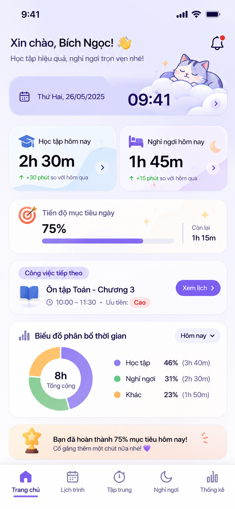

# 🌙 SleepBuddy

> Người bạn nhỏ giúp bạn **học tập tập trung** và **ngủ nghỉ điều độ**.

<p align="center">
  
</p>

SleepBuddy là một ứng dụng dành cho điện thoại Android. Bạn có thể hình dung nó như
một **cuốn sổ tay + chiếc đồng hồ nhắc việc**:

- Ghi lại việc học và giờ đi ngủ của mình.
- Đặt mục tiêu mỗi ngày rồi theo dõi tiến độ.
- Bật đồng hồ tập trung để làm việc không bị xao nhãng.
- Xem lại mình đã học và nghỉ bao nhiêu, vào ngày nào, môn nào.
- Đọc các bài cẩm nang ngắn về học tập và sức khỏe.

Mọi dữ liệu được lưu **ngay trên điện thoại của bạn**. Ứng dụng không cần đăng nhập,
không cần mạng và hiện không có tính năng đồng bộ lên đám mây.

---

## Mục lục

- [Bạn sẽ thấy gì trong ứng dụng?](#bạn-sẽ-thấy-gì-trong-ứng-dụng)
- [Cài đặt ứng dụng (dành cho người không viết code)](#cài-đặt-ứng-dụng-dành-cho-người-không-viết-code)
- [Công nghệ bên trong (giải thích dễ hiểu)](#công-nghệ-bên-trong-giải-thích-dễ-hiểu)
- [Cấu trúc thư mục](#cấu-trúc-thư-mục)
- [Dữ liệu của bạn được lưu ở đâu?](#dữ-liệu-của-bạn-được-lưu-ở-đâu)
- [Một thao tác đi qua những đâu?](#một-thao-tác-đi-qua-những-đâu)
- [Những điều cần biết trước khi dùng](#những-điều-cần-biết-trước-khi-dùng)
- [Câu hỏi thường gặp](#câu-hỏi-thường-gặp)
- [Dành cho lập trình viên](#dành-cho-lập-trình-viên)

---

## Bạn sẽ thấy gì trong ứng dụng?

Ứng dụng có **5 khu vực chính**, nằm ở thanh điều hướng dưới cùng màn hình:

| # | Khu vực | Dùng để làm gì |
|---|---------|----------------|
| 1 | **Trang chủ** (Tổng quan) | Chào bạn, hiển thị tổng giờ học và giờ nghỉ hôm nay, tiến độ mục tiêu ngày, nhiệm vụ sắp tới và biểu đồ phân bổ thời gian (hôm nay, hôm qua, tuần này, tháng này). |
| 2 | **Lịch trình** (Lịch học) | Xem bài học theo từng ngày, thêm nhiệm vụ mới (môn học, ngày, giờ bắt đầu – kết thúc, mức ưu tiên) và đánh dấu đã hoàn thành. |
| 3 | **Tập trung** | Chọn một nhiệm vụ, chạy đồng hồ tập trung hoặc nghỉ ngơi. Khi hết giờ, ứng dụng tự ghi nhận phiên học và tổng kết. |
| 4 | **Giấc ngủ** | Ghi giờ đi ngủ, giờ thức dậy, chất lượng giấc ngủ, cảm nhận và ghi chú. Đặt giờ ngủ mục tiêu và bật lời nhắc đi ngủ. |
| 5 | **Thống kê & Cài đặt** | Xem báo cáo theo ngày/tuần/tháng, thời gian theo môn học, mức hoàn thành kế hoạch; đổi giao diện sáng/tối, chỉnh thời lượng tập trung – nghỉ, bật/tắt thông báo và đọc cẩm nang. |

### Một vài điểm đáng chú ý

- **Nhắc việc thông minh:** nhắc đúng giờ bắt đầu nhiệm vụ. Nhiệm vụ ưu tiên cao có
  thông báo nổi bật hơn; ưu tiên thấp thì nhẹ nhàng, yên tĩnh hơn.
- **Nhắc đi ngủ:** dựa trên giờ bạn đặt. Nếu giờ nhắc hôm nay đã qua, ứng dụng sẽ hẹn
  sang ngày mai.
- **Sáng và tối:** giao diện có hai chế độ màu, phù hợp cả ban ngày lẫn buổi tối.
- **Cẩm nang:** các bài viết ngắn về học tập, giấc ngủ và sức khỏe, có thể tìm kiếm
  và lọc theo chủ đề.

---

## Cài đặt ứng dụng (dành cho người không viết code)

### Bạn cần chuẩn bị

- Một điện thoại **Android 7.0 trở lên**.
- File cài đặt có tên dạng `app-release.apk` (do người phụ trách dự án gửi cho bạn).
- Khoảng 2–3 phút rảnh rỗi.

### Các bước cài đặt

1. **Nhận file APK** qua Zalo, Google Drive, email… rồi tải file về điện thoại.
   Nếu file nằm trong thư mục `Download`, hãy mở ứng dụng **Files** (hoặc **Quản lý tệp**).
2. **Chạm vào file `app-release.apk`**.
3. Nếu điện thoại hỏi *“Bạn có muốn cài đặt ứng dụng từ nguồn này không?”*, hãy chọn
   **Cài đặt** / **Cho phép**. Đây là bước bình thường khi cài ứng dụng ngoài CH Play.
4. Chờ vài giây rồi chọn **Mở**.
5. Khi ứng dụng hỏi quyền **thông báo**, hãy chọn **Cho phép** để nhận lời nhắc học và
   nhắc đi ngủ.
6. Trên Android 12 trở lên, nếu được hỏi quyền **báo thức chính xác**, hãy bật để lời
   nhắc không bị trễ. Nếu bỏ lỡ bước này, bạn có thể bật lại trong phần Cài đặt của
   điện thoại.

> **Không thấy file APK?** Hãy nhờ người phụ trách gửi lại. File APK không tự có
> trong thư mục mã nguồn; nó được tạo ra khi build ứng dụng.

### Nếu muốn tự tạo file APK

Dành cho người đã cài Flutter và Android Studio:

```shell
cd sleep_buddy
flutter pub get
flutter build apk --release
```

File kết quả nằm ở:

```text
sleep_buddy/build/app/outputs/flutter-apk/app-release.apk
```

Có thể mở máy ảo Android bằng cách chạy `start_emulator.bat` ở thư mục gốc dự án
(máy ảo tên `Pixel_7_Pro`).

> ⚠️ **Lưu ý khi chia sẻ:** bản release hiện được ký bằng **debug keystore** để tiện
> thử nghiệm. Cách này chỉ phù hợp để chia sẻ nội bộ, **không dùng để đăng Google Play**.
> Muốn phát hành chính thức, cần tạo keystore riêng và cập nhật cấu hình ký trong
> `android/app/build.gradle.kts`. Xem thêm trong
> [sổ tay kỹ thuật](sleep_buddy/instructions.md).

---

## Công nghệ bên trong (giải thích dễ hiểu)

Ứng dụng được viết bằng **Flutter** — một bộ công cụ cho phép dùng cùng một bộ mã để
tạo giao diện trên nhiều loại điện thoại. Dưới đây là các thành phần chính:

| Thành phần | Công nghệ (phiên bản đang dùng) | Nhiệm vụ, nói theo cách dễ hiểu |
|------------|----------------------------------|----------------------------------|
| Bộ khung giao diện | **Flutter 3.47.9** | “Xưởng vẽ” giao diện và xử lý thao tác chạm, vuốt. |
| Ngôn ngữ lập trình | **Dart 3.13.7** | Ngôn ngữ để viết toàn bộ ứng dụng. |
| Quản lý trạng thái | **flutter_bloc 9.1.1** (Cubit) | “Người điều phối”: nhận thao tác, tải dữ liệu và báo cho giao diện biết cần vẽ lại gì. |
| Điều hướng màn hình | **go_router 17.2.3** | “Bản đồ đường đi” giữa Trang chủ, thêm nhiệm vụ, chi tiết cẩm nang… |
| Cơ sở dữ liệu | **sqflite 2.4.5** + **path 1.9.1** | Kho dữ liệu nhỏ nằm ngay trong điện thoại (SQLite), không cần máy chủ. |
| Ghi nhớ cài đặt nhỏ | **shared_preferences 2.5.6** | Ghi nhanh vài lựa chọn như trạng thái đã mở ứng dụng lần đầu. |
| Thông báo | **flutter_local_notifications 19.5.0** | Tạo lời nhắc học, nhắc hết giờ và nhắc đi ngủ ngay trên máy. |
| Múi giờ | **timezone 0.10.1** + **flutter_timezone 5.1.1** | Đặt lời nhắc đúng theo giờ địa phương, kể cả khi điện thoại dùng múi giờ lạ. |
| Xin quyền | **permission_handler 13.0.2** | Xin quyền thông báo và báo thức chính xác. |
| Biểu đồ | **fl_chart 1.3.0** | Vẽ biểu đồ tròn, biểu đồ cột trong phần Tổng quan và Thống kê. |
| Thanh tab dưới | **animated_bottom_navigation_bar 1.4.1** | Tạo thanh 5 biểu tượng có hiệu ứng chuyển động. |
| Biểu tượng | **cupertino_icons 1.0.9** | Bộ biểu tượng dùng trong giao diện. |
| Biểu tượng ứng dụng | **flutter_launcher_icons 0.14.4** | Tạo icon SleepBuddy cho Android/iOS từ một ảnh gốc. |
| Kiểm tra chất lượng code | **flutter_lints 6.0.0** | Nhắc nhở các quy tắc viết code sạch. |

### Giải thích nhanh một số thuật ngữ

- **Flutter:** giống như một bộ “đồ nghề” giúp lập trình viên dựng giao diện bằng các
  khối có sẵn (nút, thẻ, danh sách, biểu đồ) thay vì tự vẽ từng điểm ảnh.
- **Cubit:** một “người thư ký” đứng giữa giao diện và dữ liệu. Giao diện không tự đọc
  database; nó nhờ Cubit lấy dữ liệu rồi cập nhật lại màn hình.
- **SQLite:** một chiếc “hộp hồ sơ” nhỏ gọn nằm trong điện thoại, lưu dữ liệu thành các
  bảng giống như bảng tính.
- **DAO (Data Access Object):** “người giữ hộp hồ sơ”. Mọi câu lệnh đọc/ghi SQLite đều
  nằm ở đây để các phần khác không phải viết câu lệnh dữ liệu phức tạp.
- **Múi giờ IANA:** tên chuẩn quốc tế của múi giờ, ví dụ `Asia/Ho_Chi_Minh`. Một số
  điện thoại trả về tên khác thường như `GMT+07:00`; ứng dụng có cách dự phòng để vẫn
  chạy bình thường.
- **Gradle / AGP / Kotlin:** bộ công cụ phía Android dùng để “đóng gói” ứng dụng thành
  file APK. Dự án dùng Gradle 8.14.3, AGP 8.11.1 và Kotlin 2.2.20.
- **Desugaring:** một kỹ thuật giúp ứng dụng dùng được các tính năng Java mới trên cả
  điện thoại Android cũ.

### Cấu hình Android hiện tại

| Hạng mục | Giá trị |
|----------|---------|
| Phiên bản Android tối thiểu | Android 7.0 (API 24) |
| Android mục tiêu | API 36 |
| SDK biên dịch | API 37 |
| Java | 17 |
| Ký bản release | Debug keystore (chỉ để thử nghiệm/chia sẻ nội bộ) |

---

## Cấu trúc thư mục

```text
SleepBuddy/
├─ README.md               ← bạn đang đọc file này
├─ start_emulator.bat      ← mở máy ảo Android trên Windows
└─ sleep_buddy/            ← toàn bộ mã nguồn ứng dụng
   ├─ lib/                 ← “bộ não” của ứng dụng
   │  ├─ main.dart         ← điểm khởi động
   │  ├─ core/             ← phần dùng chung: database, theme, router, thông báo…
   │  └─ features/         ← từng khu vực: tổng quan, lịch học, tập trung, giấc ngủ, thống kê
   ├─ android/             ← cấu hình đóng gói APK cho Android
   ├─ assets/              ← hình ảnh minh hoạ (50 ảnh PNG)
   ├─ test/                ← các bài kiểm thử tự động
   ├─ dashboard.png        ← ảnh chụp màn hình Tổng quan
   ├─ pubspec.yaml         ← danh sách thư viện và tài nguyên
   └─ instructions.md      ← sổ tay kỹ thuật chi tiết
```

Bên trong `lib/features/`, mỗi khu vực được chia thành:

- `screens/` – các màn hình người dùng nhìn thấy.
- `widgets/` – các khối giao diện nhỏ được dùng lại.
- `cubit/` – “người điều phối” dữ liệu của khu vực đó.
- `model/` hoặc `models/` – khuôn mẫu dữ liệu.

---

## Dữ liệu của bạn được lưu ở đâu?

Tất cả nằm trong một file cơ sở dữ liệu tên là **`sleep_buddy.db`** trên điện thoại.
Ứng dụng dùng **13 bảng**:

| Bảng | Lưu gì |
|------|--------|
| `profiles` | Hồ sơ người dùng và tên hiển thị. |
| `subjects` | Danh sách môn học, màu sắc và biểu tượng. |
| `study_tasks` | Bài học/nhiệm vụ, ngày giờ, mức ưu tiên, trạng thái hoàn thành. |
| `focus_sessions` | Các phiên tập trung hoặc nghỉ ngơi thực tế. |
| `sleep_logs` | Nhật ký giấc ngủ theo từng ngày. |
| `sleep_settings` | Giờ ngủ mục tiêu, giờ nhắc và bật/tắt nhắc ngủ. |
| `guide_articles` | Danh sách bài cẩm nang. |
| `guide_steps` | Nội dung từng bước trong bài cẩm nang. |
| `guide_bookmarks` | Bài cẩm nang được đánh dấu yêu thích. |
| `guide_progress` | Tiến độ đọc cẩm nang. |
| `activity_logs` | Nhật ký hoạt động phục vụ thống kê. |
| `daily_goals` | Mục tiêu học tập/nghỉ ngơi của từng ngày. |
| `app_settings` | Cài đặt chung như giao diện sáng/tối, thời lượng tập trung, thông báo. |

**Những điều quan trọng:**

- Dữ liệu **không được gửi lên Internet**. Không có tài khoản, không có máy chủ.
- **Gỡ ứng dụng sẽ xoá dữ liệu.** Hiện chưa có tính năng sao lưu hoặc khôi phục.
- Lần đầu mở, ứng dụng có sẵn nội dung cẩm nang và mục tiêu mẫu. Danh sách nhiệm vụ
  và nhật ký ngủ bắt đầu trống để bạn tự ghi.

---

## Một thao tác đi qua những đâu?

Ví dụ khi bạn bấm **“Bắt đầu tập trung”**:

```text
Bạn chạm nút
    ↓
Màn hình (Screen) gửi yêu cầu
    ↓
Cubit kiểm tra điều kiện, chọn việc cần làm
    ↓
DAO đọc/ghi SQLite  →  Dịch vụ thông báo / đồng hồ
    ↓
Cubit tạo “trạng thái” mới
    ↓
Màn hình nhận trạng thái và vẽ lại
```

Cách chia việc này giúp:

- Giao diện chỉ lo hiển thị, không lẫn câu lệnh database.
- Dễ kiểm thử từng phần.
- Khi sửa dữ liệu, chỉ cần sửa đúng một nơi.

---

## Những điều cần biết trước khi dùng

- **Hiện hỗ trợ Android.** Mã nguồn có khung iOS nhưng chưa được cấu hình đầy đủ để
  build; bản web/Windows cũng chưa dùng được vì thư viện database chỉ hỗ trợ thiết bị
  di động.
- **Thông báo phụ thuộc vào điện thoại.** Một số máy tiết kiệm pin sẽ trì hoãn thông báo.
  Nếu lời nhắc đến trễ, hãy tắt tối ưu pin cho SleepBuddy trong phần Cài đặt điện thoại.
- **Giờ nhắc có thể lệch vài phút** nếu bạn không cấp quyền báo thức chính xác.
- **Không có đồng bộ nhiều thiết bị.** Đổi điện thoại nghĩa là bắt đầu lại từ đầu.
- **Bản release dùng ký debug**, chỉ nên chia sẻ trong nhóm/nội bộ.
- **Không có quảng cáo, không có theo dõi người dùng.**

---

## Câu hỏi thường gặp

**1. Ứng dụng có cần Internet không?**
Không. Sau khi cài đặt, bạn có thể dùng hoàn toàn ngoại tuyến.

**2. Tôi có thể dùng trên iPhone không?**
Hiện chưa có bản cài cho iPhone. Mã nguồn có thư mục iOS nhưng chưa hoàn thiện phần
cấu hình và đóng gói.

**3. Vì sao tôi không nhận được thông báo?**
Hãy kiểm tra lần lượt:
- Đã cho phép quyền thông báo cho SleepBuddy chưa?
- Đã bật thông báo trong phần **Thống kê & Cài đặt** của ứng dụng chưa?
- Điện thoại có đang bật chế độ tiết kiệm pin hoặc “Không làm phiền” không?
- Trên Android 12+, đã bật quyền báo thức chính xác chưa?

**4. Tắt thông báo thì lời nhắc đã hẹn có tự mất không?**
Có. Khi thông báo bị tắt, ứng dụng sẽ huỷ các lời nhắc đã hẹn. Khi bật lại, các lời
nhắc trong tương lai sẽ được tạo lại.

**5. Gỡ ứng dụng rồi cài lại có mất dữ liệu không?**
Có. Dữ liệu nằm trên máy và bị xoá cùng ứng dụng, vì hiện chưa có sao lưu.

**6. Tôi nhập nhầm giờ ngủ thì sửa được không?**
Được. Màn hình Giấc ngủ cho phép ghi và chỉnh lại giờ ngủ, giờ thức, ghi chú và cảm nhận.
Ứng dụng không cho lưu giờ thức trong tương lai hoặc khoảng ngủ dài từ 24 giờ trở lên.

**7. Vì sao danh sách nhiệm vụ trống?**
Ứng dụng không tạo sẵn nhiệm vụ học. Hãy vào **Lịch trình** và thêm nhiệm vụ đầu tiên.

**8. Ứng dụng có thu thập dữ liệu của tôi không?**
Hiện không có tính năng gửi dữ liệu lên máy chủ, không có quảng cáo và không có tài
khoản trực tuyến.

---

## Dành cho lập trình viên

Nếu bạn muốn đọc, sửa hoặc mở rộng mã nguồn, hãy xem **sổ tay kỹ thuật**:

👉 **[sleep_buddy/instructions.md](sleep_buddy/instructions.md)**

Sổ tay đó mô tả chi tiết:

- Kiến trúc Screen → Cubit → DAO → SQLite.
- Vai trò từng thư mục và từng DAO.
- Quy ước khi thêm tính năng mới.
- Cách thông báo và múi giờ hoạt động (kèm cách xử lý lỗi múi giờ trên một số máy).
- Cách chạy test, build APK và những giới hạn hiện tại.

### Yêu cầu môi trường

- Flutter **3.47.9** (stable) và Dart **3.13.7** (đã kiểm tra thực tế).
- Android SDK, Java 17 và Android Studio (hoặc dòng lệnh Flutter).
- `pubspec.yaml` khai báo ràng buộc Dart `^3.10.0-290.4.beta`.

### Lệnh thường dùng

```shell
cd sleep_buddy
flutter pub get          # tải thư viện
flutter run              # chạy trên máy ảo/điện thoại đang kết nối
flutter analyze          # kiểm tra code
flutter test             # chạy kiểm thử
flutter build apk --release
```

> Ghi chú: dự án hiện là mã nguồn phục vụ học tập/nội bộ và **chưa có giấy phép
> mã nguồn mở**. Hãy liên hệ người phụ trách trước khi dùng lại mã nguồn.
